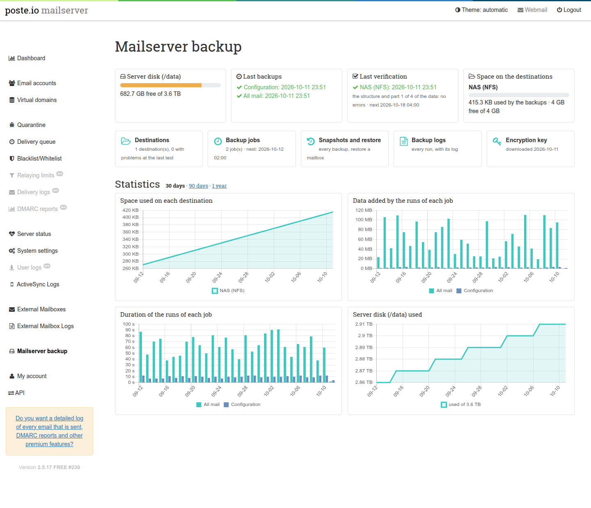

# Backup and restore

Encrypted, scheduled backups of a Poste.io server, made and checked from the
admin: the server configuration, all the mail or only some mailboxes, sent to
one or more destinations at the same time (SMB/Samba, SFTP, S3, or a volume
mounted by the host such as NFS).

> **Status of this add-on.** This page describes what is in the repository
> now. The add-on is being built in stages; what a stage does not do yet is
> said where it matters (for example restoring from the admin: today restores
> are done from the command line, see [Restoring](#restoring)).



The add-on is independent of the others and of anything outside the
container: it does not need a backup system on the host. If the host already
backs up the whole machine (a hypervisor snapshot, a VM backup), this add-on
adds what those cannot give: backups of the mail server alone, off the
machine, encrypted, frequent, with single mailboxes to restore.

- [What is backed up](#what-is-backed-up)
- [How it works](#how-it-works)
- [The encryption key](#the-encryption-key)
- [Destinations](#destinations)
- [Backup jobs](#backup-jobs)
- [Restoring](#restoring)
- [Security](#security)
- [Files and folders](#files-and-folders)
- [Troubleshooting](#troubleshooting)
- [Limits](#limits)
- [Removing it](#removing-it)

## What is backed up

A job backs up the **server configuration**, the **mail**, or both.

**Configuration** (a few megabytes):

| What | From |
|---|---|
| accounts, domains, aliases, passwords (hashed), limits | `/data/users.db`, copied with SQLite's own backup command while in use, then checked with an integrity check |
| calendars and address books (DAV) | `/data/dav.db`, same way |
| webmail settings, identities, address books | `/data/roundcube/roundcube.db` (it belongs to the webmail: the database and its write-ahead log are copied, again if they changed meanwhile, and the copy is checked) |
| server settings | `/data/server.ini`, `/data/instance-id` |
| TLS certificates (also Let's Encrypt) | `/data/ssl` |
| DKIM keys of each domain | `/data/domains/<domain>/private`, `public`, `selector` |
| spam filter training (rspamd's Bayes, in redis) | `/data/redis/dump.rdb` |
| ActiveSync device states | `/data/zpush` |
| settings of the add-ons and of Poste.io under `/data/var` | everything there except the virus database (downloaded again) and this add-on's own folder |

**Mail**: either all of it (`/data/domains`, every mailbox with its folders
and its filters, plus the messages held in quarantine) or only the mailboxes
chosen in the job (their whole home folder: mail and filters).

**Never backed up**: the encryption key and the add-on's settings (they hold
the passwords of the destinations: see [Security](#security)), logs, the
outgoing mail queue, the virus database, the cached rule maps of the spam
filter (downloaded again), and the webmail's PGP keyrings (`roundcube/enigma`:
readable only by the webmail; users who use PGP in Roundcube export their keys
from there). More generally, a file of the configuration that the user `mail`
cannot read is left out on purpose, and each run's log says how many.

## How it works

Two parts:

- the **admin** saves settings and requests;
- the **engine** (`/usr/local/bin/poste-backup`, run by cron every minute)
  does the backups. It reads the settings and **validates them again** before
  using anything in them.

Both run as the user **`mail`**, the user Poste.io's admin already runs as and
that owns the mail. The backup never runs as root: whatever the admin's
settings say, the engine cannot do more than the admin itself could (see
[Security](#security)).

The backups are made by [restic](https://restic.net): encrypted, with
deduplication (a file already stored is never stored again, so an hourly
backup of a large server stores only what changed), checked by content. Remote
destinations are reached through [rclone](https://rclone.org). Both come from
the Debian packages of the image.

Each **destination** holds its own restic **repository**, and every job writes
a full, independent copy to each of its destinations: losing one destination
loses nothing. One destination can serve several jobs.

Each run of a job:

1. copies the databases in a consistent state and checks the copies;
2. for each destination: checks it (a local folder must be a mounted volume,
   not on the disk of `/data`), creates the repository there **only if the
   folder is empty** (a folder with other files is never written to), backs
   up, then removes the old snapshots of that job according to its keep rules;
3. records the result for the admin (state and history).

A destination that fails does not stop the others. One run at a time: a long
backup makes the next minutes wait (a lock), it is never started twice.

## The encryption key

Every backup is encrypted with a key made at the first start of the container
(`/data/var/backup/settings/restic.key`, 48 random bytes). **Without the key
no backup can be read**, not by you and not by anyone who gets hold of the
destination.

The key is not part of any backup (a backup protected by a key stored inside
it would be useless). **Download it** from *Backup > Encryption key* and keep
it outside the server, where you keep your other passwords. The admin shows a
warning until it has been downloaded once.

The key is never replaced: if the file is deleted, a new one is made at the
next start, and that new key cannot read the backups made before. Put the old
key back instead (same file, owner `mail`, mode `0600`).

## Destinations

*Backup > Destinations > Add a destination.* Every destination can be tested
from its page: the test checks that it can be reached, that the folder is
empty or already a repository, the free space, and writes and removes a small
file. Use **one folder per mail server**.

### SMB / Samba

Server, share, folder inside the share, user, password, and the domain if the
server needs one. Works with Samba, Windows shares and NAS shares (SMB 2 or
newer). The free space is shown.

### SFTP

Server, port, user, folder, and a login **with a password** or **with a key**:

- *with a key*: the admin makes a key pair (ed25519) for this destination and
  shows the public key; add it to `~/.ssh/authorized_keys` of that user on the
  server;
- **the server's own SSH key must be confirmed** before anything is sent. The
  first test shows the fingerprints the server offers; compare them with the
  server's (`ssh-keygen -lf /etc/ssh/ssh_host_ed25519_key.pub` on the server)
  and confirm. From then on a different key stops the backups instead of
  sending them to whoever answers. Changing the server or the port asks for a
  new confirmation.

The folder is required (the repository must not land among the user's own
files).

### S3

Endpoint (`https://...`), region (if the provider needs it), bucket, folder
inside the bucket, access key and secret key. Works with Amazon S3 and with
S3-compatible services (MinIO, Backblaze B2, Wasabi, Ceph, ...). If the bucket
does not exist it is created, when the key is allowed to. S3 does not report
free space.

### A volume mounted by the host (NFS, a second disk, ...)

A container cannot mount network file systems itself (it would need
privileges that make it far less safe), so the host mounts the share and
passes it to the container as a volume, under `/backup`, `/mnt`, `/srv` or
`/media`. For example with Docker Compose and an NFS export:

```yaml
services:
  mailserver:
    # ...
    volumes:
      - ./data:/data
      - nfs-backup:/backup/nfs

volumes:
  nfs-backup:
    driver: local
    driver_opts:
      type: nfs
      o: "addr=nas.example.lan,rw,nfsvers=4"
      device: ":/export/mail-backup"
```

Then add a destination of type *Folder* with the path `/backup/nfs`. The
engine refuses a folder that is **not a mount point** (the backup would stay
inside the container and vanish with it), that is **on the same disk as
`/data`** (it would not survive the loss of that disk), or that it **cannot
write**: the backups are written by the user `mail`, **uid 8, gid 8**. Give the
folder of the volume to that user (for an NFS export: a directory owned by
8:8 on the server, and an export that does not squash that user).

## Backup jobs

*Backup > Backup jobs > Add a backup job:*

- **What**: the server configuration, and no mail / all mail / only some
  mailboxes;
- **When**: every hour (at a minute), every day, every week (a day) or every
  month (day 1 to 28) at a time. Times are the server's time zone;
- **Destinations**: one or more, each gets a full copy;
- **Keep**: how many hourly, daily, weekly and monthly snapshots to keep. After
  each run the older snapshots of **that job** are removed: for each hour,
  day, week and month the last snapshot is kept, up to these numbers (restic's
  `forget --keep-*`, then `--prune`). At least one number must be above 0.
  Example: 24 hourly, 7 daily, 4 weekly, 12 monthly = every hour for a day,
  every day for a week, every week for a month, every month for a year.

A job runs when its time comes; **Run now** (or *Save and run now*) starts it
within a minute. A run missed because the server was off runs once, as soon
as the server is back (not once per missed hour). A new job does not run for
a time that was already past when it was created.

The page shows, for each job, the last run on each destination: how much new
data it stored, how long it took, or the error.

## Restoring

> Restoring from the admin (a mailbox into a folder *Restored …* of the same
> mailbox, the whole server onto a new installation, browsing a snapshot) is
> the next stage of this add-on. Until then, restores are done from the
> command line, as below: everything needed is already in the container.

`poste-backup restic <destination id> <restic command>` runs restic on a
destination's repository with its settings and the key. The ids are in the
admin's addresses (`/admin/backup/destinations/<id>/edit`) and in
`/data/var/backup/settings/config.json`.

```bash
# the snapshots on a destination
docker exec mailserver poste-backup restic 0a1b2c3d4e5f snapshots

# what is in the latest snapshot of a job
docker exec mailserver poste-backup restic 0a1b2c3d4e5f ls latest --tag job:<job id>

# one mailbox back, into a separate folder (nothing is overwritten)
docker exec mailserver poste-backup restic 0a1b2c3d4e5f restore latest \
    --target /tmp/restore --include /data/domains/example.com/alice
```

The restored mailbox is then in `/tmp/restore/data/domains/example.com/alice`;
copy the messages you need back into the mailbox's `Maildir` (owner `mail`),
or into a new folder of it, for example:

```bash
docker exec mailserver sh -c 'H=/data/domains/example.com/alice; U=alice@example.com
  mkdir -p "$H/Maildir/.Restored/cur" "$H/Maildir/.Restored/new" "$H/Maildir/.Restored/tmp" &&
  cp -a "/tmp/restore$H/Maildir/cur/." "$H/Maildir/.Restored/cur/" &&
  chown -R mail:mail "$H/Maildir/.Restored" &&
  doveadm force-resync -u "$U" "*" && doveadm mailbox subscribe -u "$U" Restored'
```

This copies the messages of the inbox (`Maildir/cur`); the other folders are
`Maildir/.<name>/cur` (Poste.io stores mail in the Maildir++ layout: `.Sent`,
`.Junk`, ...). The procedure is run by the add-on's tests, as written here.

The databases are in the snapshot as consistent copies under
`/data/var/backup/engine/staging/` (`users.db`, `dav.db`, `roundcube.db`).

`poste-backup` always runs as the user `mail` (started as root, it switches),
so the restored files belong to `mail`. That is right for the mail and for
Poste.io's own files owned by `mail`; a file that belongs to another user on
the server (for example the webmail's `roundcube.db`, owned by `www-data`)
needs its owner set back by root after copying it into place
(`chown www-data:www-data ...`).

## Security

- **No root.** The admin and the engine both run as `mail`. In Poste.io
  `/data` itself belongs to `mail`, so a program running as root there could
  be led by `mail` (with a symbolic link, a renamed folder, a changed database
  row) to read or write files it should not. Running the backups as `mail`
  removes that whole class of problems: nothing the admin writes can make the
  engine read or write more than `mail` already can. Root only makes
  `/data/var/backup` at start (after checking that `/data/var` is a real folder
  owned by root) and gives it to `mail`.
- **Mailbox folders** come from Poste.io's database: a folder is used only if it
  is exactly two levels under `/data/domains`, with no `.`/`..` part and no
  symbolic link anywhere in the path.
- **Everything is checked twice.** The admin refuses invalid values; the
  engine validates the settings file again before using it. Server names,
  folders, users and keys are checked against strict patterns (a folder can
  never look like an option, nothing can contain `..`), and commands are never
  run through a shell.
- **Secrets.** The passwords of the destinations and the encryption key are on
  the volume, readable by `mail` and root only, never sent back to the browser
  (a password field left empty keeps the saved one), passed to rclone through
  its environment ("obscured" through stdin, never on a command line). The
  settings with the passwords are not part of the backups: after rebuilding a
  server from a backup, enter the destinations again.
- **The backups** are encrypted with the key before leaving the server; the
  destination only ever sees encrypted data. They contain all the mail and the
  hashed passwords of the accounts: keep the destinations and the key safe.
- **SFTP** only talks to a server whose SSH key was confirmed.
- **Only super administrators** see the pages.

## Files and folders

```
/usr/local/bin/poste-backup               the engine: tick, run, status, restic (as mail;
                                          started as root it switches to mail)
/usr/local/lib/poste-backup/lib/          its PHP library (shared with the admin's validation)
/etc/cron.d/poste-backup                  runs "poste-backup tick" every minute, as mail
/etc/cont-init.d/90-backup.sh             at every start: the folder (root), then folders
                                          inside and the key (once) as mail

/data/var/backup/                         mail:mail 0750
  settings/                               (the admin)
    config.json                           destinations and jobs (0600)
    restic.key                            the encryption key (0600)
    key-downloaded, tests.json            when the key was downloaded, last tests
    queue/                                "run now" requests
    ssh/<id>, <id>.pub                    key pairs of SFTP destinations
  engine/                                 (the engine)
    state.json                            last run of each job
    history.jsonl                         one line per run and destination
    logs/                                 output of each run (the last 200)
    staging/                              consistent copies of the databases, during a run
/var/cache/poste-backup                   restic's cache (rebuilt when needed)
/run/poste-backup.lock                    one run at a time
```

## Troubleshooting

```bash
docker exec mailserver poste-backup status          # last results
docker exec mailserver ls -t /data/var/backup/engine/logs | head
docker exec mailserver poste-backup run <job id>    # run a job now and wait for it
```

The dashboard says when the engine has not run for more than ten minutes
(while no backup is running): cron is then not running in the container. It
also shows why the start script could not prepare the backup folder, if that
happened (`/run/poste-backup.start-error`): for example `/data/var` replaced by
something that is not a folder owned by root.

## Limits

- **One repository per server**: do not point two mail servers to the same
  folder.
- restic and rclone are the versions of the image's Debian release (restic
  0.14, rclone 1.60 on Poste.io 2.5.17).
- The first backup of a large server takes a while (everything is new); later
  ones store only what changed.
- S3 does not report free space.

## Removing it

Build without the section. What stays in the volume is `/data/var/backup`
(settings, key, state). The backups on the destinations are not touched:
keep the key if you may need them.
