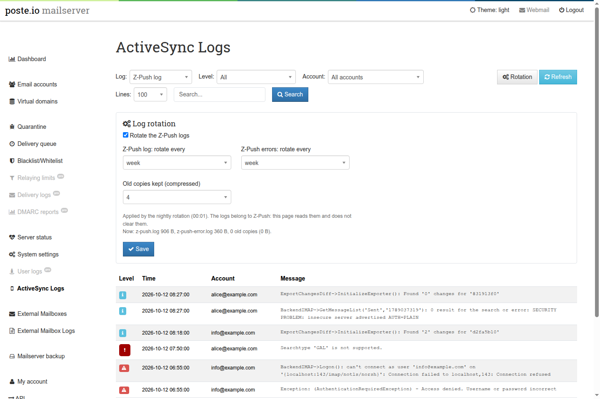

# ActiveSync logs in the admin

A page of the Poste.io admin, **ActiveSync Logs**, to read the logs of Z-Push
(the ActiveSync server phones talk to) and to set their rotation. Without it
these logs are only inside the container, and Poste.io never rotates them:
on a server with a couple of phones `z-push.log` grows by a few megabytes a
month, forever.



The add-on is independent of the others: Z-Push and its logs are part of every
Poste.io, with or without [calendars and contacts over
ActiveSync](activesync-dav.md).

## The page

The entry is in the left menu right after **User logs**, for super admins
only.

- **Log**: `z-push.log` (everything Z-Push writes at its log level, INFO in
  Poste.io) or `z-push-error.log` (only its warnings and errors).
- **Level**: all lines, warnings and errors, or errors only (Z-Push's `ERROR`
  and `FATAL`).
- **Account**: the accounts found in the last 20,000 lines of the log; pick
  one to see only its lines.
- **Lines** and **Search** (plain text, case-insensitive).

The filters apply to the whole file, then the last 25–500 matching lines are
shown, newest first. Each line shows Z-Push's level (warnings yellow, errors
red), the time, the account and the message; a message that Z-Push writes
over two lines is shown as one. The page refreshes itself every 30 seconds.

What you typically find there: a phone with a wrong password
(`AuthenticationRequiredException`), a phone asking for something the server
does not offer (`Searchtype 'GAL' is not supported`), IMAP refusing Z-Push's
connection (mail server down), and at every sync the INFO line *"SECURITY
PROBLEM: insecure server advertised AUTH=PLAIN"*: Z-Push talks to Poste.io's
IMAP on `localhost` without TLS, which is noise, not a risk from outside.

There is **no Clear button**, on purpose. The logs belong to Z-Push (user
`www-data`, mode `0644`), and Poste.io gives them back to `www-data` at every
start; the admin runs as `mail` and can read them, not change them. Making
them writable by the admin would mean changing permissions that Poste.io sets.
The rotation keeps them small instead.

## Log rotation

**Rotation** opens the settings: on/off, how often each log is rotated (every
day, week or month), how many old copies are kept, compressed (1–12). The
defaults are weekly for both and 4 copies. A line under the settings shows the
current size of the two logs and of the old copies.

It works like the [log rotation of External
Mailboxes](external-mailboxes.md#log-rotation). The admin runs as `mail` and
cannot write logrotate rules, which must belong to root, so:

1. the admin saves the settings in `/data/var/activesync-logs/log-rotation.ini`
   (on the volume: they survive rebuilds and upgrades), with its own CSRF token
   and only the values offered by the form;
2. a root script, `/usr/local/bin/activesync-logs-logrotate`, turns them into
   `/etc/logrotate.d/activesync-logs` every night at 00:00, one minute before
   Poste.io's logrotate, and at every container start. A change made in the
   admin applies from the next night.

The settings file is written by a less privileged user and read by root: the
script executes nothing from it and accepts only the allowed values
(`enabled` 0/1, `zpush_every` and `errors_every` daily/weekly/monthly, `keep`
1/2/4/8/12); anything else means the default.

The rule rotates the two logs as `www-data` (`su www-data www-data`) and
recreates them `0644` owned by `www-data`, as Poste.io has them. No
`copytruncate` is needed: Z-Push opens the file again for every line it
writes, so it continues in the new file at once.

```
/data/var/activesync-logs/log-rotation.ini   settings (admin, mail, 0640)
/usr/local/bin/activesync-logs-logrotate     writes the rule (root)
/etc/cron.d/activesync-logs-logrotate        runs it at 00:00
/etc/cont-init.d/90-activesync-logs.sh       at every start: the settings folder, then the rule
/etc/logrotate.d/activesync-logs             the rule, used by logrotate at 00:01
```

## Existing installations

Nothing to do by hand. `/data` is a volume, so a folder prepared in the image
would be hidden on an installation that already has one; the settings folder
is therefore created at every container start by
`/etc/cont-init.d/90-activesync-logs.sh` (a start script run as root by the
image's init, after Poste.io's own), which also writes the rule: from the
first night the logs are rotated with the default settings, until they are
changed in the page.

## Files

| File | Role |
|---|---|
| `activesync-logs/admin/src/Base/Controller/ActiveSyncLogsController.php` | the page and the saving of the settings |
| `activesync-logs/admin/templates/Base/ActiveSyncLogs/` | the page and its table (the table is reloaded every 30 seconds) |
| `activesync-logs/activesync-logs.{en,cs}.yml` | translations |
| `activesync-logs/activesync-logs-logrotate` + `.cron` | the root script and its nightly run |
| `activesync-logs/90-activesync-logs.sh` | start script: settings folder and rule |
| `activesync-logs/activesync-logs-install.sh` | installs everything above and adds the menu entry |

`activesync-logs-install.sh` is the only part that touches a Poste.io file:
it adds three lines to the menu template right after **User logs**. It refuses
to run if it does not find that entry exactly once, followed by its `</li>`,
so a Poste.io update that changes the menu breaks the build instead of leaving
the page without its entry.

## Removing it

Build without the section. What stays in the volume is
`/data/var/activesync-logs` (the settings) and, in `/data/log/z-push`, the old
copies made by the rotation (`*.log.1`, `*.log.N.gz`); remove them if you no
longer need them. The Z-Push logs themselves are Poste.io's and stay where
they were.
