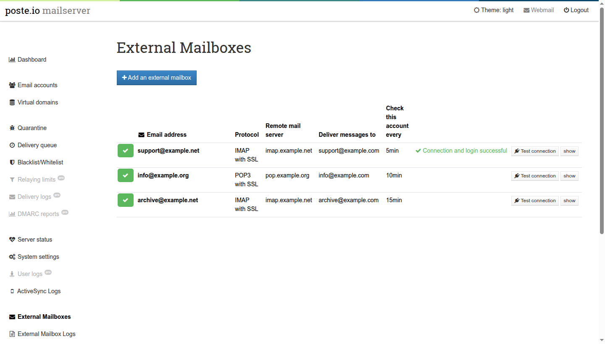
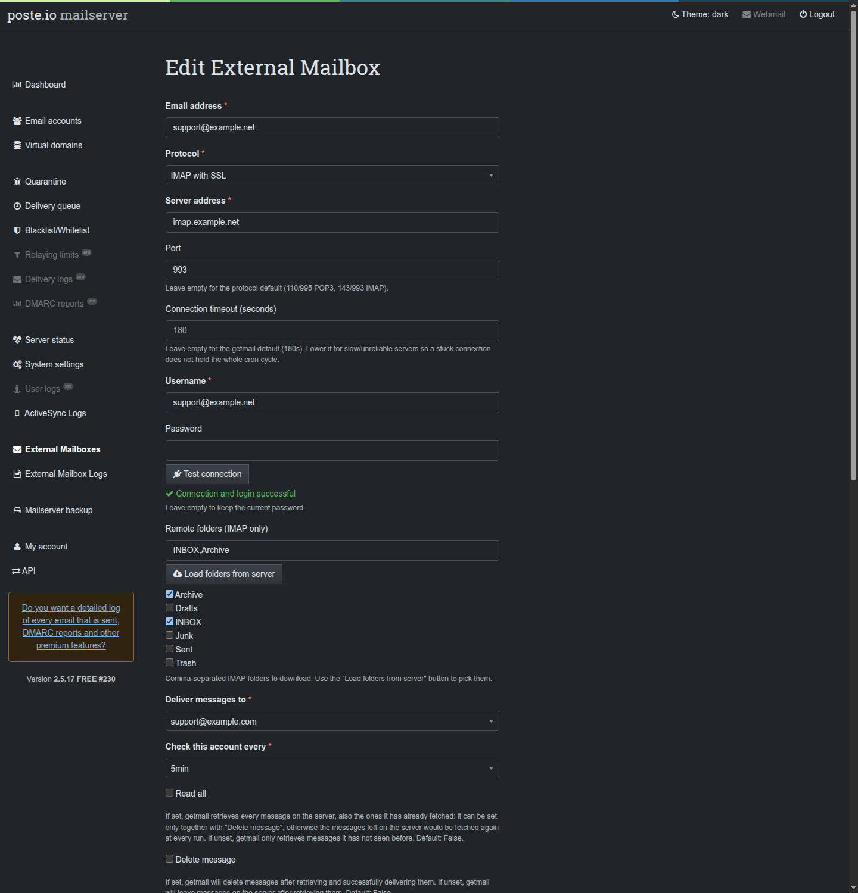
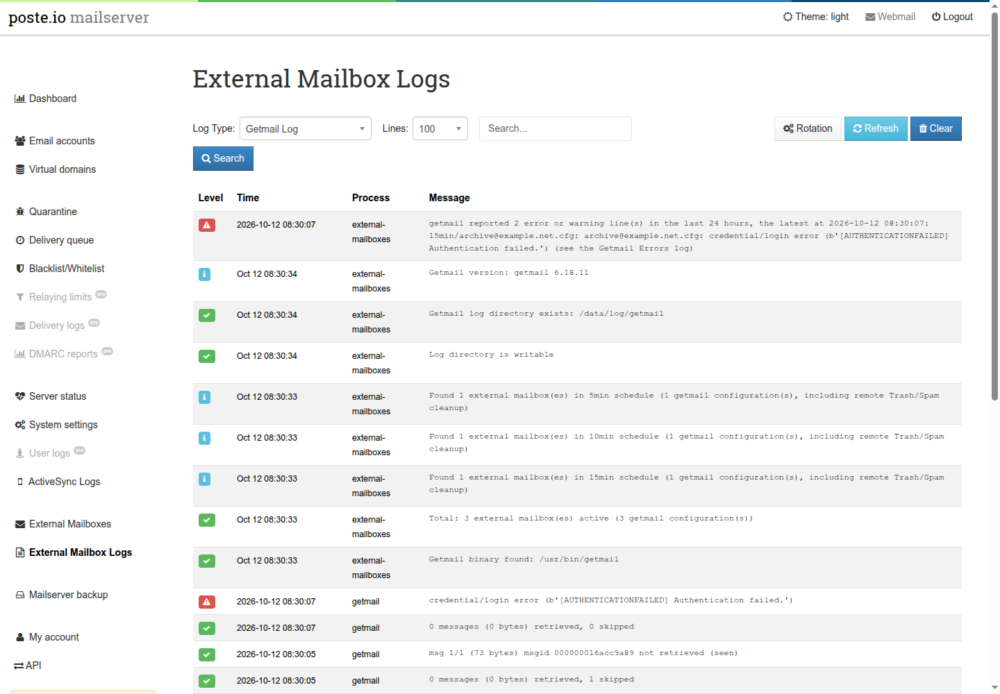
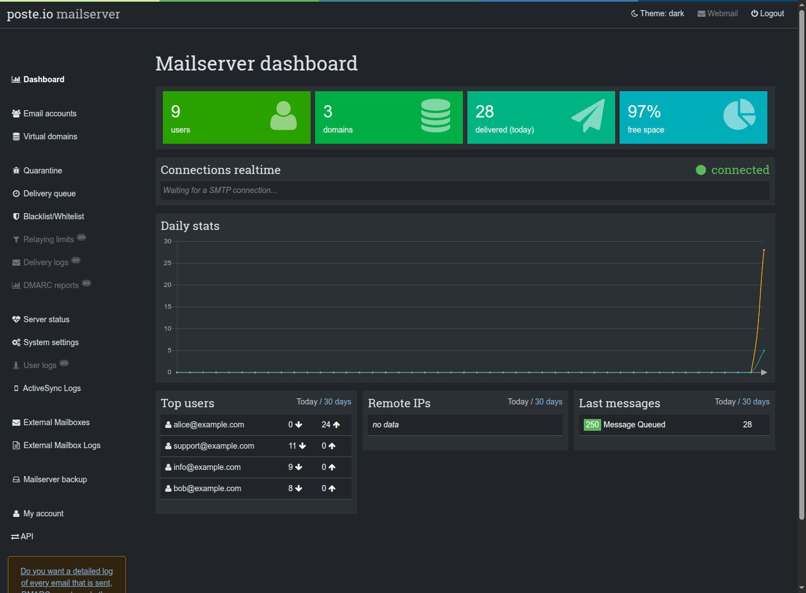
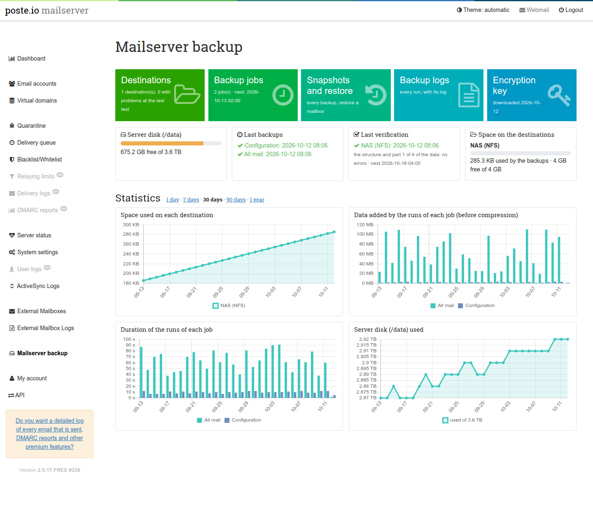

# poste.io-addons

[](testing.md)
[](https://github.com/atsanna/poste.io-addons/blob/main/LICENSE)
[-2b9348.svg)](installation.md)

Add-ons for the [Poste.io](https://poste.io) mail server, built as a Docker
image on top of the official one:

- **External Mailboxes** — fetch mail from POP3/IMAP accounts hosted elsewhere
  and deliver it into Poste.io on a schedule, managed from the admin.
- **Dark theme for the admin** — automatic (follows the system) with a switch
  in the top bar.
- **Calendars and contacts over ActiveSync** — the phone's Exchange account
  gets the calendars and contacts of Poste.io's DAV server, not only the mail.
- **ActiveSync logs in the admin** — read the Z-Push logs with filters, and
  rotate them (Poste.io never does).
- **Backup and restore** — encrypted, scheduled backups of the configuration
  and the mail to SMB, SFTP, S3 or a mounted volume, set up and watched from
  the admin.
- **Three upstream fixes** that make "move to Junk" actually teach rspamd,
  without leaving a copy of each message in `/tmp`.

Take all of them or only the ones you want: each add-on is one section of the
Dockerfile ([choosing the add-ons](choosing-addons.md)).

English and Czech, like the Poste.io admin. Dockerfiles for the Pro and the
open source edition: in production on **Poste.io 2.5.17 PRO #230**; the open
source image is built and tested end to end on every push, with all the
add-ons and with each one alone ([tests](testing.md)).

> Not affiliated with or endorsed by Poste.io / Analogic. "Poste.io" is a
> trademark of its owners; this project only contains add-ons and no Poste.io
> code.



## Features

### External Mailboxes



- POP3, POP3 over SSL, IMAP and IMAP over SSL, via
  [getmail6](https://github.com/getmail6/getmail6), every 5–60 minutes.
- Delivery to any local mailbox **or redirect**: deliver an external
  `support@` box to a redirect and everyone in it gets the mail.
- IMAP folder picker (**Load folders from server**) and optional cleanup of
  the remote Trash/Spam folders with a retention period.
- **Test connection** from the form and from every row of the list.
- getmail options in the form: read all/new, delete, delete after N days,
  limits per run, delete messages over a size, port, timeout. "Read all" only
  together with "Delete message" (otherwise everything left on the server
  would be fetched again at every run).
- **Spam check**: every fetched message goes through rspamd before delivery,
  like mail received over SMTP (headers, spam into Junk, Bayes); without it
  fetched mail is not scanned by Poste.io at all.
- Logs page with the getmail log, the **getmail errors** (with a red line on
  top of the getmail view when there are recent ones), the cron log and a
  status view; **log rotation** set from the same page.
- Hardened: getmail runs as `mail`, never root; configuration files `0600`;
  TLS certificates verified; passwords never sent back to the browser; explicit
  CSRF tokens; strict validation of every value written to getmail.

→ [External Mailboxes](external-mailboxes.md)



### Dark theme



- Follows the system setting, or force light/dark from the top bar (remembered
  by the browser).
- No white flash on load; the login page follows the system too.
- Charts are recoloured and redrawn when the theme changes.
- The light theme is untouched: every rule applies to the dark theme only.

→ [Dark theme](dark-theme.md)

### Calendars and contacts over ActiveSync

- One Exchange/ActiveSync account on the phone: mail, calendars, tasks and
  contacts, both ways, from Poste.io's built-in CalDAV/CardDAV server.
- Enabled per mailbox in the admin, as before (*Create calendar*, *Create
  address book*); a mailbox without them keeps mail only.
- A colleague's calendar shared **read-only** appears as an additional
  calendar: see whether someone is busy before booking them.
- If the DAV server is switched off or broken, mail keeps working.
- Fixes three Z-Push issues found while testing (an event refused by the
  server confirmed as saved, a crash on contacts without an address book,
  ActiveSync down with the DAV server).

→ [Calendars and contacts over ActiveSync](activesync-dav.md) (existing installations:
devices must resync once)

### ActiveSync logs

- A page right after *User logs* with the Z-Push log and its errors log:
  filter by level, account and text, newest lines first.
- Log rotation set from the same page (Poste.io never rotates these logs):
  every day, week or month, old copies kept compressed.
- Read-only on purpose: the logs stay Z-Push's (`www-data`), as Poste.io
  wants them.

→ [ActiveSync logs](activesync-logs.md)

### Backup and restore



- The **configuration** (accounts, domains, settings, certificates, DKIM keys,
  calendars and address books, webmail settings, spam filter training) and
  **all the mail or chosen mailboxes**, every hour, day, week or month.
- To one or more destinations at once: **SMB/Samba, SFTP, S3**, a volume
  mounted by the host (NFS, a second disk), or restic's **REST server in
  append-only mode**, where a compromised mail server cannot delete the
  backups; a **Test** of each destination before saving it (reachable, empty
  folder, free space, a write).
- Made with [restic](https://restic.net): encrypted before leaving the
  server, deduplicated and compressed, so frequent backups store only what
  changed; keep rules per job (hourly, daily, weekly, monthly).
- Live progress, the log of every run, the space on each destination (yellow
  and red from limits you set), **statistics** over 30 days to a year, and a
  scheduled **verification** of each destination that reads the stored data
  again, a part at a time.
- **Restore a mailbox from the admin** into a new folder of the same or
  another mailbox: whole, some folders, the messages of a filter (dates,
  sender, subject), or **single messages** found in a searchable list;
  nothing already there is changed; remove the backups of a
  job; the backups read from **another machine with only the key file**; a
  **whole server rebuilt** on a new installation, each procedure run by the
  tests as documented.
- Hardened: the engine runs as `mail`, never root; settings validated again
  before use; SFTP only to a server whose SSH key was confirmed; passwords
  never sent back to the browser.

→ [Backup and restore](backup.md)

### Upstream fixes

On 2.5.17 moving a message to Junk does not train rspamd: the learning scripts
are world-writable (Dovecot refuses to run them) and they learn into a Bayes
bucket that scanning never reads. The Dockerfiles fix both, and the build fails
if Poste.io changes the scripts, so the fixes never silently stop applying.

→ [Upstream fixes](upstream-fixes.md)

## Quick start

```bash
git clone https://github.com/atsanna/poste.io-addons.git
cd poste.io-addons

# Pro (requires docker login to the Poste.io registry)
docker build -f Dockerfile-pro --build-arg POSTE_IO_VERSION=2.5.17 -t my/poste.io:2.5.17 .
# or open source
docker build -f Dockerfile     --build-arg POSTE_IO_VERSION=2.5.17 -t my/poste.io:2.5.17 .

# only some add-ons, e.g. the dark theme and calendars/contacts
sh select-addons.sh Dockerfile-pro dark-theme activesync-dav > Dockerfile.custom
docker build -f Dockerfile.custom --build-arg POSTE_IO_VERSION=2.5.17 -t my/poste.io:2.5.17 .
```

Run the image as you run the official one (see
[`docker-compose.example.yml`](https://github.com/atsanna/poste.io-addons/blob/main/docker-compose.example.yml)). On an **existing**
installation, read [Installation](installation.md#3-existing-installations-the-data-volume)
first: the `/data` volume hides the folders the image prepares, and phones
using ActiveSync must resync once.

## License

[MIT](https://github.com/atsanna/poste.io-addons/blob/main/LICENSE) © 2026 Antonio Sanna. The license covers the files of this
repository only; Poste.io itself is licensed by its owners.
