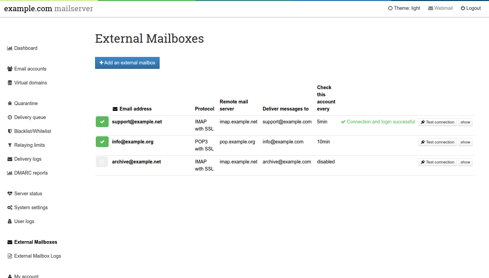
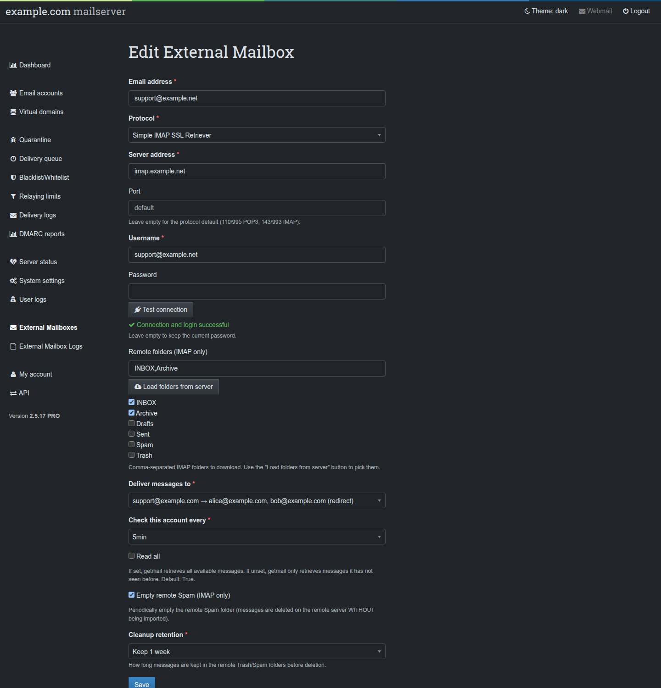

# External Mailboxes

Fetches mail from mailboxes hosted elsewhere (POP3 or IMAP, with or without
SSL) and delivers it into Poste.io, on a schedule, with
[getmail6](https://github.com/getmail6/getmail6). Everything is configured from
the Poste.io admin (super admins only): **External Mailboxes** and
**External Mailbox Logs** in the left menu.



## What it does

- **Protocols**: POP3, POP3 over SSL, IMAP, IMAP over SSL.
- **Schedule**: every 5, 10, 15, 30 or 60 minutes, or disabled.
- **Delivery**: to any local mailbox **or redirect** (alias). Delivery goes
  through Poste.io itself (`sendmail` → Haraka, inside the container), so
  filters and redirects apply: deliver an external `support@` mailbox to a
  local redirect and every member of the redirect gets a copy. In the
  destination menu redirects are shown as `support@example.com → alice@example.com (redirect)`.
- **IMAP folders**: choose which remote folders to download; **Load folders
  from server** lists the real folders of the account.
- **Remote cleanup (IMAP)**: optionally empties the remote Trash and/or Spam
  folders after a retention period (immediately, 1 day … 1 month). If a folder
  is both imported and cleaned up, "immediately" is raised to 1 day so a
  message can never be deleted before it is imported.
- **getmail options**: read all / only new messages, delete after download,
  delete after N days, add a `Received:` header, log to syslog, limits per run
  (messages and bytes, useful for the first import of a large mailbox), delete
  messages bigger than N bytes on the server, custom port and connection
  timeout.
- **Test connection**: one login on the remote server, from the form (with the
  values being edited) and from every row of the list (with the saved
  configuration). Never automatic, and a single attempt per click: providers
  lock accounts after repeated failures.
- **Logs page**: the getmail log, the cron log, syslog and the mail log, with
  search, a line limit, auto-refresh and a status view (getmail version,
  folders, number of external mailboxes per schedule).
- **Translations**: English and Czech, like the rest of the Poste.io admin
  (the browser chooses).



## How it works

The "database" is the file system, inside the `/data` volume:

```
/data/var/getmail/
├── 5min/ 10min/ 15min/ 30min/ 60min/   one .cfg per mailbox; the folder is the schedule
├── disabled/                            mailboxes not scheduled
├── cron.sh                              the runner
└── <schedule>/oldmail-*                 getmail's memory of already fetched messages
/data/log/getmail/getmail.log            operational log
```

A mailbox with remote cleanup has up to three files in its folder:
`user@example.com.cfg` (download), `user@example.com.trash.cfg` and
`user@example.com.spam.cfg` (fetch → discard to `/bin/true` → delete on the
server). The cleanup files are not listed separately: they are created,
updated and removed together with their mailbox.

The crontab of the **`mail`** user (`/etc/external-mailboxes.crontab`) runs
`cron.sh <folder>` for each schedule; `cron.sh` runs getmail on each `.cfg`
with `flock -n`, so a slow mailbox never overlaps with itself. getmail never
runs as root.

## Security

- **Files**: `/data/var/getmail` and `/data/log/getmail` belong to `mail:mail`,
  folders `0750`, `.cfg` and `oldmail-*` files `0600`. The admin (php-fpm runs
  as `mail`) writes them, cron reads them as `mail`.
- **Passwords**: getmail needs them in clear text in the `.cfg` files, so they
  are stored there (readable only by `mail`). They are **never sent back to the
  browser**: when editing, an empty password field means "keep the saved one",
  and the saved password is read and rewritten untouched.
- **Saved password and the test buttons**: with an empty password field,
  "Test connection" and "Load folders" use the saved password **only if
  protocol, server, port and username are exactly the saved ones**; otherwise
  they ask for it. Without this rule, changing the server in the form would be
  enough to send the saved password to any host.
- **TLS**: for the SSL protocols the generated configuration sets `ca_certs`,
  so getmail verifies the server certificate and its name (without it getmail
  uses `CERT_NONE`). "Test connection" and "Load folders" verify it too.
  The non-SSL protocols are plain text, as their name says.
- **CSRF**: Poste.io disables Symfony's form CSRF protection
  (`fos_rest.yaml`, `disable_csrf_role: PUBLIC_ACCESS`), so every form and AJAX
  call of the module carries its own explicit token, checked by the controller.
- **Validation**: protocol, schedule and retention must be values offered by
  the form; the email address becomes a file name and is checked against a
  strict pattern (no `/`, no `..`); the server name too; the destination must
  be an existing mailbox or redirect; values written into the `.cfg` file
  cannot contain line breaks (they would inject configuration lines).

## Notes and limitations

- **Gmail / Microsoft 365**: OAuth2 is not supported. Gmail accepts IMAP with an
  *app password* (2-step verification required) using the IMAP SSL protocol and
  `imap.gmail.com`; this was not tested by the author, use **Test connection**
  to check your account. Gmail folders are named like `[Gmail]/Spam`.
- **Multidrop** (one catch-all remote mailbox sorted by original recipient) is
  not offered: to send one external mailbox to several people, deliver it to a
  redirect.
- **POP3 test**: c-client accepts neither half-open nor read-only POP3
  sessions, so the test opens `INBOX`; it closes without expunge, so no message
  is deleted.
- The status lines of the logs page are log output and stay in English.
